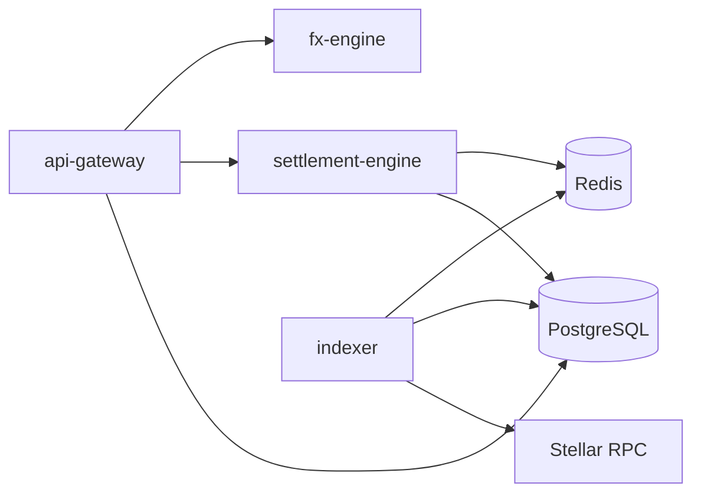

# Service dependency graph

The gateway is the public entry point. FX quotes are provided by `fx-engine`; settlement creation and reconciliation are handled by `settlement-engine`; `indexer` consumes Stellar events and delivers webhooks. PostgreSQL is the durable store and Redis backs queues, locks, caches, and health checks. Internal service calls require `INTER_SERVICE_SECRET`.
